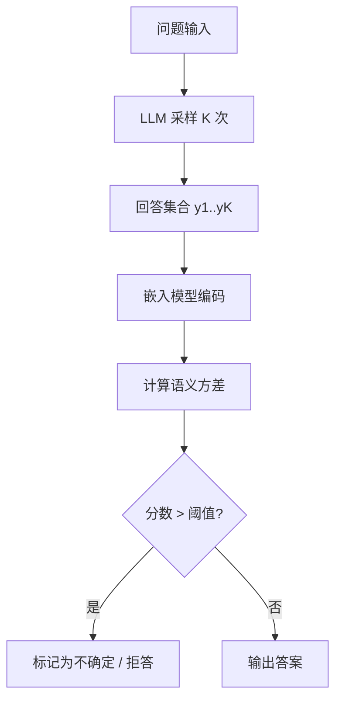

# 语义不确定性估计

用语义空间中的方差来衡量模型对一个问题**回答一致程度**的方法。

## 核心思想

传统不确定性用 token 级概率（熵、似然）衡量，但同一个意思可以有无数种表述方式。
语义不确定性做法：

1. 对同一个问题采样 $K$ 个回答 $\{y_1, \dots, y_K\}$
2. 用嵌入模型把每个回答映射到语义空间 $z_k = f(y_k)$
3. 计算语义方差作为不确定性分数

$$
u_{\text{sem}} = \frac{1}{K}\sum_{k=1}^{K} \min_{j \neq k} d(z_k, z_j)
$$

其中 $d(\cdot,\cdot)$ 是余弦距离。

## 采样策略对比

| 方法 | 采样次数 | 效果 | 说明 |
|---|---|---|---|
| 贪心解码 | 1 | 差 | 无多样性，无法衡量一致性 |
| 温度采样 | K | 好 | 需要合理设置 temperature |
| 束搜索 | K | 中 | 回答往往过于相似 |
| 自我一致性 | K | 最好 | 结合多数投票 |

## 评测流程

```python
def semantic_uncertainty(question, model, embedder, K=12):
    answers = [model.generate(question, temperature=0.9) for _ in range(K)]
    z = [embedder.encode(a) for a in answers]
    scores = []
    for k in range(K):
        others = [j for j in range(K) if j != k]
        scores.append(min(cosine_dist(z[k], z[j]) for j in others))
    return sum(scores) / K
```

## 流程图



## 注意事项

- [x] 嵌入模型的质量直接决定结果
- [ ] 采样次数 K 与成本强相关
- [ ] 多跳推理场景下需要分阶段评估

> 参考文献：Kuhn et al., *Semantic Uncertainty: Linguistic Invariances for Uncertainty Estimation in Natural Language Generation*, ICLR 2023。

公式行内示例：当 $K=1$ 时该方法退化为确定性输出，无法估计不确定性。
